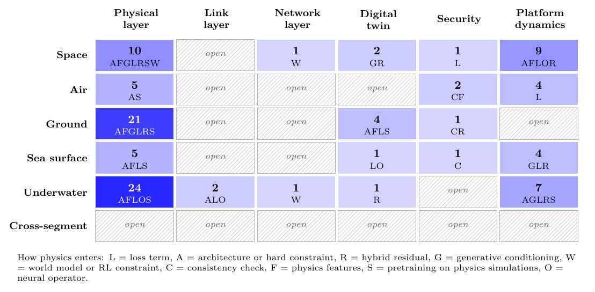
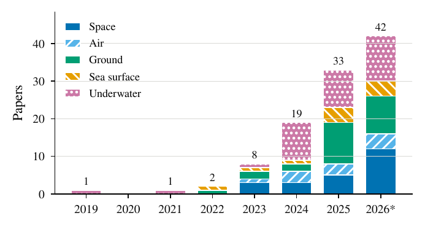
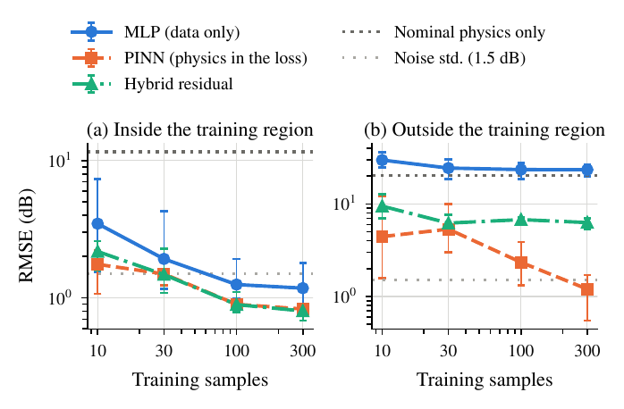
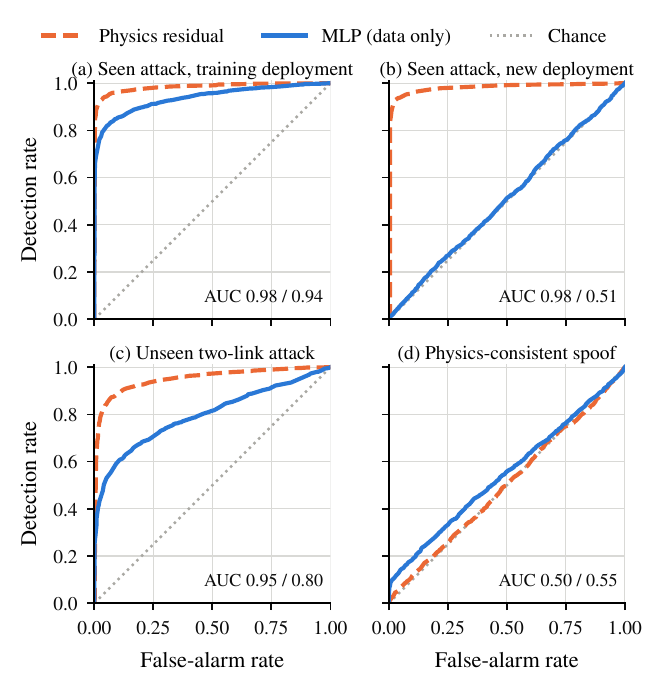

# PIML-SAGSIN-Survey: Physics-Informed Machine Learning for Space-Air-Ground-Sea Integrated Networks

[](https://awesome.re)
[](LICENSE)


Companion repository of a tutorial and survey. A curated list of **physics-informed machine learning (PIML)** for **space-air-ground-sea integrated networks (SAGSIN)**:
satellites and non-terrestrial networks, UAVs and HAPS, terrestrial radio, maritime links and underwater acoustic and optical networks.

This repository accompanies the article

> M. Jouhari, "Physics-Informed Machine Learning for Space-Air-Ground-Sea Integrated Networks: A Tutorial and Survey," 2026. *(arXiv link will be added here.)*

It contains the list of surveyed papers organized by the taxonomy of the article (segment × layer × how physics enters),
the full screening table, the verified BibTeX file, and the code of the two worked examples.

**Inclusion rule.** A paper is listed as PIML work only if it embeds an identifiable physical law (a governing equation, a propagation law, or a geometric or dynamic model) in its features, loss, architecture or decision process. Related work that uses physical knowledge without embedding a law is listed separately. Every entry was checked against Crossref or arXiv.

## Contents

- [Taxonomy](#taxonomy)
- [How physics enters: mechanism codes](#how-physics-enters-mechanism-codes)
- [Space](#space)
- [Air](#air)
- [Ground](#ground)
- [Sea surface](#sea-surface)
- [Underwater](#underwater)
- [Cross-segment and interfaces (open)](#cross-segment-and-interfaces-open)
- [Related work without an embedded physical law](#related-work-without-an-embedded-physical-law)
- [PIML methods (general)](#piml-methods-general)
- [Datasets, simulators and benchmarks](#datasets-simulators-and-benchmarks)
- [Data-driven baselines and classic models](#data-driven-baselines-and-classic-models)
- [Surveys and background](#surveys-and-background)
- [Code of the worked examples](#code-of-the-worked-examples)
- [Repository layout](#repository-layout)
- [Contributing](#contributing)
- [Citation](#citation)

## Taxonomy

Number of PIML papers per SAGSIN segment (rows) and layer or function (columns). Empty cells are open research problems.



| Segment | Physical layer | Link layer | Network layer | Digital twin | Security | Platform dynamics | Total |
|---|---|---|---|---|---|---|---|
| Space | 10 | open | 1 | 2 | 1 | 9 | 23 |
| Air | 5 | open | open | open | 2 | 4 | 11 |
| Ground | 21 | open | open | 4 | 1 | open | 26 |
| Sea surface | 5 | open | open | 1 | 1 | 4 | 11 |
| Underwater | 24 | 2 | 1 | 1 | open | 7 | 35 |
| Cross-segment | open | open | open | open | open | open | 0 |
| **Total** | 65 | 2 | 2 | 8 | 5 | 24 | **106** |

Papers per year: 2019: 1, 2021: 1, 2022: 2, 2023: 8, 2024: 19, 2025: 33, 2026: 42.



## How physics enters: mechanism codes

| Code | Mechanism | How physics enters |
|---|---|---|
| F | Physics features | Quantities computed by a law are given as inputs |
| L | Loss term | Residual of a governing equation is penalized (PINN) |
| A | Architecture or hard constraint | The network structure satisfies the law by construction |
| R | Hybrid residual | A physics model gives the main effect, a network learns the correction |
| G | Generative conditioning | Physical quantities condition or guide a generative model |
| O | Neural operator | An operator maps environments (e.g., sound-speed profiles) to fields |
| W | World model or RL constraint | A physical model predicts outcomes or masks infeasible actions |
| C | Consistency check | Observations are compared with a physical prediction (security, anomalies) |
| S | Simulation pretraining | A physics simulator generates training data |

## Space

### Space: Physical layer (10)

- **Deep Learning-Based Channel Prediction for LEO Satellite Communications under Dynamic Propagation Conditions**. Ekolama *et al.*, *Journal of High-Frequency Communication Technologies*, 2026. [[link]](https://doi.org/10.58399/kuac4786)<br>  Mechanism: **L** · Physics: Doppler-gradient regularization (orbital kinematics) · Data: measured + simulated (420 h Ku-band, 50k passes) · Reported: 18-32% over baselines; -70.3% handover failures
- **Deep State-Space Modeling of Channel Dynamics for CSI Prediction in LEO Non-Terrestrial Networks**. Hameed *et al.*, *IEEE Transactions on Vehicular Technology*, 2026. [[link]](https://doi.org/10.1109/tvt.2026.3655374)<br>  Mechanism: **A** · Physics: Doppler shifts placed in state-matrix eigenvalues · Data: simulated (3GPP NTN)
- **Collaborative Method for OTFS Channel Estimation and Prediction Based on LEO Satellite-Ground Link**. He *et al.*, *IEEE Transactions on Cognitive Communications and Networking*, 2026. [[link]](https://doi.org/10.1109/tccn.2025.3618264)<br>  Mechanism: **F** · Physics: Doppler and link distance as LSTM inputs (DDI-LSTM) · Data: simulated
- **An Improved Neural-Network to Estimate the Inputs of Rino's Ionospheric Scintillation Model**. Molina *et al.*, *IEEE Journal of Selected Topics in Applied Earth Observations and Remote Sensing*, 2026. [[link]](https://doi.org/10.1109/jstars.2025.3625408)<br>  Mechanism: **A** · Physics: NN estimates inputs of Rino's scintillation model · Data: measured (past datasets)
- **AI-Driven Modeling of the S4 Index for UHF Satellite Communication**. Reis *et al.*, *IEEE Access*, 2026. [[link]](https://doi.org/10.1109/access.2026.3692417)<br>  Mechanism: **S** · Physics: NN emulates GISM scintillation model for UHF links · Data: simulated (GISM)
- **Physics-Guided Channel Prediction for LEO Satellite MIMO Systems**. Tao *et al.*, *Proceedings of the 5th International Conference on Computer, Artificial Intelligence and Control Engineering*, 2026. [[link]](https://doi.org/10.1145/3804601.3804638)<br>  Mechanism: **F, G** · Physics: FSPL, atmospheric, rain fade, scintillation priors fused by FiLM · Data: simulated · Reported: +27.73% spectral efficiency vs outdated CSI
- **Physics-Informed Reinforcement Learning for Utility-Aware Pilot Selection in LEO Channel Estimation**. Wan *et al.*, *IEEE Transactions on Wireless Communications*, 2026. [[link]](https://doi.org/10.1109/twc.2026.3679026)<br>  Mechanism: **F, W** · Physics: Doppler-induced dynamics as low-rank complex-exponential basis (PiSBEM-LMMSE) for DRL state · Data: simulated
- **Low Earth Orbit Satellite Channel Modeling Based on Latent Diffusion Models and Physics-Informed Neural Networks**. Xia *et al.*, *2025 International Conference on Signal Processing and Communication Technology (SPCT)*, 2025. [[link]](https://doi.org/10.1109/spct68223.2025.11406771)<br>  Mechanism: **L** · Physics: Maxwell and Doppler constraints in latent encoder · Data: n.s. · Reported: 34.6% NMSE reduction vs baseline
- **A Novel Ionospheric Inversion Model: PINN-SAMI3 (Physics Informed Neural Network Based on SAMI3)**. Ma *et al.*, *Space Weather*, 2024. [[link]](https://doi.org/10.1029/2023sw003823)<br>  Mechanism: **L** · Physics: SAMI3 continuity, momentum, temperature equations in loss · Data: simulated · Reported: better than ANN with sparse data
- **ANN_ITU: Predicting rain attenuation with a hybrid model for earth-space links**. Xu *et al.*, *Proceedings of the Institution of Mechanical Engineers, Part G: Journal of Aerospace Engineering*, 2023. [[link]](https://doi.org/10.1177/09544100231202930)<br>  Mechanism: **R** · Physics: ITU-R P.618-12 rain attenuation corrected by ANN · Data: measured (DBSG3) · Reported: outperforms ITU-R and data-driven

### Space: Network layer (1)

- **QoS- and Physics-Aware Routing in Optical LEO Satellite Networks via Deep Reinforcement Learning**. Dabiri *et al.*, *arXiv:2512.20835 [eess.SP]*, 2025. [[link]](https://arxiv.org/abs/2512.20835) `preprint`<br>  Mechanism: **W** · Physics: Jitter-aware Gaussian-beam feasibility as DRL action mask · Data: simulated (Starlink-like)

### Space: Digital twin (2)

- **Physics-Conditional Diffusion for High-Fidelity Channel Digital Twins in Non-Terrestrial Networks**. Huang *et al.*, *2026 IEEE/CIC International Conference on Communications in China (ICCC)*, 2026. [[link]](https://doi.org/10.1109/iccc70295.2026.11680148)<br>  Mechanism: **G** · Physics: Orbital kinematics + environment prior tensors · Data: real-world datasets
- **Physics-Informed Digital Twins for Channel Estimation and Traffic Prediction of Non-Terrestrial Networks**. Huang *et al.*, *arXiv:2605.23155 [eess.SP]*, 2026. [[link]](https://arxiv.org/abs/2605.23155) `preprint`<br>  Mechanism: **G, R** · Physics: Physical prior tensors for CSI; physics traffic baseline + learned residual · Data: simulated with real Starlink ephemeris and ERA5

### Space: Security (1)

- **Generalized GNSS spoofing detection in unseen scenarios using physics-constrained neural networks with code-carrier consistency**. Song *et al.*, *Satellite Navigation*, 2026. [[link]](https://doi.org/10.1186/s43020-026-00199-8)<br>  Mechanism: **L** · Physics: GNSS code-carrier consistency · Data: measured (TEXBAT, OAKBAT, FGI) · Reported: >98% accuracy; ARR > 92.7% on unseen scenarios

### Space: Platform dynamics (9)

- **Physics-informed neural network for predicting orbital parameters of Low Earth Orbit satellites using two line element dataset**. Mahmud *et al.*, *Advances in Space Research*, 2026. [[link]](https://doi.org/10.1016/j.asr.2026.01.017)<br>  Mechanism: **L** · Physics: Orbital dynamics constraints (PINN-LSTM) · Data: measured (TLE) · Reported: position +87%, velocity +70% (IRIDIUM 7)
- **AutoOrbit: Physics-Informed Satellite Orbit Prediction**. Zhang *et al.*, *Proceedings of the 32nd ACM SIGKDD Conference on Knowledge Discovery and Data Mining V.2*, 2026. [[link]](https://doi.org/10.1145/3770855.3818960)<br>  Mechanism: **O, R** · Physics: Physics-informed FNO + global reference orbit + maneuver correction · Data: measured (3 operational satellites) · Reported: 62.71 m at 30 min; >60% over baselines
- **Refining satellite trajectories with celestial body features using neural networks**. Calderon *et al.*, *Expert Systems with Applications*, 2025. [[link]](https://doi.org/10.1016/j.eswa.2025.127453)<br>  Mechanism: **F, R** · Physics: SGDP4 + GRU correction with Sun/Moon positions · Data: measured
- **Orbit Determination Using Physics-Informed Neural Networks**. Loshelder *et al.*, *AIAA SCITECH 2025 Forum*, 2025. [[link]](https://doi.org/10.2514/6.2025-1931)<br>  Mechanism: **L** · Physics: Orbital equation of motion as PINN constraint · Data: simulated
- **Perturbation Orbit Prediction Method Based on Physics-Informed ResNet**. Zhao *et al.*, *IFAC-PapersOnLine*, 2025. [[link]](https://doi.org/10.1016/j.ifacol.2025.11.304)<br>  Mechanism: **L** · Physics: J2 perturbation equations in loss (ResNet) · Data: simulated · Reported: lower loss than non-physics model
- **Machine learning meets Kepler: inverting Kepler's equation for All vs All conjunction analysis**. Otto *et al.*, *Machine Learning: Science and Technology*, 2024. [[link]](https://doi.org/10.1088/2632-2153/ad51cc)<br>  Mechanism: **L, O** · Physics: Kepler equation PDEs in physics-informed DeepONet · Data: synthetic · Reported: RMSE 0.136 vs 0.568 XGBoost; 3.2x faster filter
- **Physics-Informed Neural Networks for Satellite State Estimation**. Varey *et al.*, *2024 IEEE Aerospace Conference*, 2024. [[link]](https://doi.org/10.1109/aero58975.2024.10521414)<br>  Mechanism: **R** · Physics: Astrodynamics model + NN for unmodeled acceleration · Data: simulated · Reported: obs. residual 123 -> 1.00 arcsec
- **A Physic-Informed Neural Network Approach to Orbit Determination**. Scorsoglio *et al.*, *The Journal of the Astronautical Sciences*, 2023. [[link]](https://doi.org/10.1007/s40295-023-00392-w)<br>  Mechanism: **L** · Physics: Orbital dynamics ODE regularizer (ELM) · Data: simulated · Reported: comparable to batch LS, no initial guess
- **Orbit Propagation from Historical Data using Physics-informed Neural ODEs**. Subramanian *et al.*, *2023 International Conference on Machine Learning and Applications (ICMLA)*, 2023. [[link]](https://doi.org/10.1109/icmla58977.2023.00248)<br>  Mechanism: **A** · Physics: Physics-informed neural ODE · Data: measured (TLE, Celestrak) · Reported: lower error than SGP4 over 7 days

## Air

### Air: Physical layer (5)

- **Non-Stationary UAV A2G Channel Characterization: From Urban Measurements to Expert-Assisted Neural Modeling**. Huang *et al.*, *IEEE Transactions on Vehicular Technology*, 2026. [[link]](https://doi.org/10.1109/tvt.2026.3671317)<br>  Mechanism: **A** · Physics: Expert channel laws in attention network · Data: measured (70 MHz urban campaign)
- **Physics-Informed Uncertainty-Aware Beamforming for HAPS Massive MIMO under Imperfect CSI**. Sarhan *et al.*, *arXiv:2606.29074 [eess.SP]*, 2026. [[link]](https://arxiv.org/abs/2606.29074) `preprint`<br>  Mechanism: **A** · Physics: LoS steering manifold and elevation-dependent Rician geometry in a VAE; learned uncertainty in robust beamforming (MADDPG) · Data: simulated · Reported: better EE, SINR robustness, outage and runtime than imperfect-CSI, SDR and no-VAE baselines
- **PIKAN: Physics-Inspired Kolmogorov-Arnold Networks for Explainable UAV Channel Modelling**. Tekbıyık *et al.*, *2026 IEEE Aerospace Conference*, 2026. [[link]](https://doi.org/10.1109/aero66936.2026.11519945)<br>  Mechanism: **A** · Physics: Free-space and two-ray laws as inductive bias (KAN) · Data: measured (A2G) · Reported: comparable accuracy with 232 params, up to 37x lighter
- **Predicting AAM Path Loss through Neural Networks and Statistical Modeling**. Wielnad *et al.*, *2024 Integrated Communications, Navigation and Surveillance Conference (ICNS)*, 2024. [[link]](https://doi.org/10.1109/icns60906.2024.10550570)<br>  Mechanism: **S** · Physics: CNN trained on ray tracing · Data: simulated · Reported: 100x faster than ray tracing
- **Air-to-Ground Path Loss Model at 3.6 GHz under Agricultural Scenarios Based on Measurements and Artificial Neural Networks**. Li *et al.*, *Drones*, 2023. [[link]](https://doi.org/10.3390/drones7120701)<br>  Mechanism: **S** · Physics: Ray-tracing pretraining with RT pre-correction · Data: measured (3.6 GHz farmland) · Reported: better than empirical models

### Air: Security (2)

- **Physics-Informed Anomaly Detection for Unmanned Aerial Vehicles**. Guo *et al.*, *IEEE Robotics and Automation Letters*, 2025. [[link]](https://doi.org/10.1109/lra.2025.3598666)<br>  Mechanism: **C** · Physics: UAV dynamics prediction residual · Data: simulated + real flights · Reported: ROC-AUC up to +17.77%
- **A Physics-Informed Residual and Particle Swarm Optimization Framework for Physics-Informed UAV GPS Spoofing Detection**. Ma *et al.*, *Sensors*, 2025. [[link]](https://doi.org/10.3390/s25226925)<br>  Mechanism: **C, F** · Physics: Temporal and carrier-level residuals · Data: measured (real GPS spoofing dataset) · Reported: 95.26% accuracy

### Air: Platform dynamics (4)

- **Local Three-Dimensional Wind Estimation for Fixed-Wing UAVs via a Physics-Informed GRU with Measurement-Noise-Adaptive Kalman Smoothing**. Tian *et al.*, *Drones*, 2026. [[link]](https://doi.org/10.3390/drones10090712)<br>  Mechanism: **L** · Physics: Wind triangle and attitude rotations in airspeed-closure loss · Data: simulated (PX4/JSBSim) · Reported: RMSE -37.4% vs vanilla GRU (OOD)
- **PI-WAN: A Physics-Informed Wind-Adaptive Network for Quadrotor Dynamics Prediction in Unknown Environments**. Wang *et al.*, *2025 IEEE/RSJ International Conference on Intelligent Robots and Systems (IROS)*, 2025. [[link]](https://doi.org/10.1109/iros60139.2025.11247234)<br>  Mechanism: **L** · Physics: Physics-informed loss in TCN dynamics model + MPC · Data: simulated + real flights
- **Physics-Informed Neural Networks for Unmanned Aerial Vehicle System Estimation**. Bianchi *et al.*, *Drones*, 2024. [[link]](https://doi.org/10.3390/drones8120716)<br>  Mechanism: **L** · Physics: Quadrotor dynamics with uncertain thrust and drag factors · Data: simulated with real data · Reported: outperforms EKF
- **Physics-informed Neural Network for Quadrotor Dynamical Modeling**. Gu *et al.*, *Robotics and Autonomous Systems*, 2024. [[link]](https://doi.org/10.1016/j.robot.2023.104569)<br>  Mechanism: **L** · Physics: Quadrotor dynamics in PINN · Data: simulated (AirSim)

## Ground

### Ground: Physical layer (21)

- **RadioDUN: A Physics-Inspired Deep Unfolding Network for Radio Map Estimation**. Chen *et al.*, *IEEE Transactions on Cognitive Communications and Networking*, 2026. [[link]](https://doi.org/10.1109/tccn.2026.3683882)<br>  Mechanism: **A, L** · Physics: Propagation/shadowing model unfolded · Data: simulated
- **REM-Net+: Quantified 3D Radio Environment Map Construction Guided by Radio Propagation Model**. Chen *et al.*, *IEEE Transactions on Vehicular Technology*, 2026. [[link]](https://doi.org/10.1109/tvt.2025.3623917)<br>  Mechanism: **F** · Physics: Least-squares propagation model supplies PL features · Data: simulated (challenge)
- **An RT-Supervised Simulation-to-Simulation Framework for Path Loss Radio Map Prediction Based on Geographic Environmental Information**. Huai *et al.*, *Electronics*, 2026. [[link]](https://doi.org/10.3390/electronics15081750)<br>  Mechanism: **R** · Physics: FSPL prior + learned excess loss · Data: simulated (ray tracing) · Reported: cross-city RMSE 9.35 dB
- **PIHG: Physics-Inspired Heterogeneous Graph Neural Networks for Multi-Band Radio Map Prediction**. Jiang *et al.*, *IEEE Transactions on Wireless Communications*, 2026. [[link]](https://doi.org/10.1109/twc.2026.3734160)<br>  Mechanism: **A, L** · Physics: Physical knowledge for coarse map + propagation-aware heterogeneous graph · Data: simulated (multi-band dataset)
- **Robust Pathloss Radio Map Prediction via Physics-Informed Transformer**. Liang *et al.*, *2026 IEEE International Symposium on Spectrum Innovation (DySPAN)*, 2026. [[link]](https://doi.org/10.1109/dyspan69846.2026.11571154)<br>  Mechanism: **A** · Physics: Tx-Rx terrain profile as token sequence · Data: simulated (TIREM) · Reported: smaller error tails than CNN-UNet
- **PhySNet: Physics-Inspired Spectral-Spatial Decoupled Attention for Radio Map Estimation**. Qiu *et al.*, *IEEE Communications Letters*, 2026. [[link]](https://doi.org/10.1109/lcomm.2026.3705413)<br>  Mechanism: **A** · Physics: FFT decomposition into large-scale trend and local variation · Data: simulated (ray tracing)
- **RadioDiff-$k^2$: Helmholtz Equation Informed Generative Diffusion Model for Multi-Path Aware Radio Map Construction**. Wang *et al.*, *IEEE Journal on Selected Areas in Communications*, 2026. [[link]](https://doi.org/10.1109/jsac.2025.3641105)<br>  Mechanism: **G** · Physics: Helmholtz equation guides dual diffusion model · Data: simulated · Reported: SOTA; latency a few hundred ms
- **Wireless AI Evolution: From Statistical Learners to Electromagnetic-Guided Foundation Models**. Xiao *et al.*, *IEEE Communications Magazine*, 2026. [[link]](https://doi.org/10.1109/mcom.001.2500367)<br>  Mechanism: **S** · Physics: Electromagnetic information theory in pretraining · Data: simulated
- **PhysRes-Net: A Physics-Informed Residual Learning Framework for Radio Map Construction in 6G AI-Native Networks**. Zhang *et al.*, *2026 Global 6G Conference (Global 6G)*, 2026. [[link]](https://doi.org/10.1109/global6g69473.2026.11566753)<br>  Mechanism: **R** · Physics: Path-loss branch + learned residual · Data: n.s. · Reported: NMSE -44.97%
- **GeNeRT: A Physics-Informed Approach to Intelligent Wireless Channel Modeling via Generalizable Neural Ray Tracing**. Bian *et al.*, *arXiv:2506.18295 [cs.LG]*, 2025. [[link]](https://arxiv.org/abs/2506.18295) `preprint`<br>  Mechanism: **A** · Physics: Fresnel-inspired polarization in neural ray tracing · Data: simulated + measured fine-tuning · Reported: -35.36 dB vs -10.85 dB in unseen scenario
- **Enhancing Urban Wireless Path Loss Prediction With Physics-Based Deep Learning and OpenStreetMap Features**. Calist *et al.*, *2025 International Symposium on Antennas and Propagation (ISAP)*, 2025. [[link]](https://doi.org/10.23919/isap63122.2025.11361834)<br>  Mechanism: **F, L** · Physics: Ray-tracing-based physics constraints + OSM features · Data: measured (UMa, UMi) · Reported: >90% variance explained
- **A physics-informed Airy beam learning framework for blockage avoidance in sub-terahertz wireless networks**. Chen *et al.*, *Nature Communications*, 2025. [[link]](https://doi.org/10.1038/s41467-025-62443-0)<br>  Mechanism: **A** · Physics: Near-field EM, ray and wave optics for Airy beams · Data: measured (sub-THz experiment)
- **Physics-Informed Representation Alignment for Sparse Radio-Map Reconstruction**. Jia *et al.*, *Proceedings of the 33rd ACM International Conference on Multimedia*, 2025. [[link]](https://doi.org/10.1145/3746027.3758161)<br>  Mechanism: **G, L** · Physics: Helmholtz residual + diffusion · Data: simulated · Reported: +37.2% accuracy at 1% sampling
- **Sparse-Guided RadioUNet with Adaptive Sampling for the MLSP 2025 Sampling-Assisted Pathloss Radio Map Prediction Data Competition**. Kojima *et al.*, *2025 IEEE 35th International Workshop on Machine Learning for Signal Processing (MLSP)*, 2025. [[link]](https://doi.org/10.1109/mlsp62443.2025.11204292)<br>  Mechanism: **F** · Physics: Reflection, transmission and distance maps as inputs · Data: simulated (ray tracing)
- **ReVeal: A Physics-Informed Neural Network for High-Fidelity Radio Environment Mapping**. Shahid *et al.*, *2025 IEEE International Symposium on Dynamic Spectrum Access Networks (DySPAN)*, 2025. [[link]](https://doi.org/10.1109/dyspan64764.2025.11115911)<br>  Mechanism: **L** · Physics: Derived second-order PDE for RSSI · Data: measured (ARA testbed) · Reported: RMSE 1.95 dB with 30 samples over 514 km2
- **Multi-Path Aware Radio Map Construction for 6G Environment-Aware Communication: A Helmholtz Equation-Informed Approach**. Wang *et al.*, *2025 IEEE/CIC International Conference on Communications in China (ICCC)*, 2025. [[link]](https://doi.org/10.1109/iccc65529.2025.11148641)<br>  Mechanism: **L** · Physics: Helmholtz equation in training · Data: simulated · Reported: 2x performance, 60x efficiency vs prior SOTA
- **A Physics-Informed Deep Ray Tracing Network for Regional Channel Impulse Response Estimation**. Wang *et al.*, *IEEE Transactions on Wireless Communications*, 2025. [[link]](https://doi.org/10.1109/twc.2025.3549498)<br>  Mechanism: **A** · Physics: Propagation principles in U-Net blocks and parameter-free transmission module · Data: simulated (ray tracing) · Reported: NRMSE 0.1226 vs RT
- **Physics-Informed Neural Networks for Path Loss Estimation by Solving Electromagnetic Integral Equations**. Jiang *et al.*, *IEEE Transactions on Wireless Communications*, 2024. [[link]](https://doi.org/10.1109/twc.2024.3429196)<br>  Mechanism: **L, R** · Physics: Volume integral equation in loss · Data: simulated (RadioMapSeer, RSRPSet)
- **From Data-Driven Learning to Physics-Inspired Inferring: A Novel Mobile MIMO Channel Prediction Scheme Based on Neural ODE**. Xiao *et al.*, *IEEE Transactions on Wireless Communications*, 2024. [[link]](https://doi.org/10.1109/twc.2023.3338419)<br>  Mechanism: **A** · Physics: Channel variation as ODE (neural ODE, SCGnet) · Data: simulated
- **Physics-Informed Neural Networks for Pathloss Prediction**. Limmer *et al.*, *2023 IEEE 33rd International Workshop on Machine Learning for Signal Processing (MLSP)*, 2023. [[link]](https://doi.org/10.1109/mlsp55844.2023.10285952)<br>  Mechanism: **L** · Physics: Spatial loss-field dependencies in training · Data: measured
- **C-GRBFnet: A Physics-Inspired Generative Deep Neural Network for Channel Representation and Prediction**. Xiao *et al.*, *IEEE Journal on Selected Areas in Communications*, 2022. [[link]](https://doi.org/10.1109/jsac.2022.3180800)<br>  Mechanism: **A** · Physics: Image-source geometry · Data: simulated

### Ground: Digital twin (4)

- **Prediction of Wireless Channel Statistics With Ray Tracing and Uncalibrated Digital Twin**. Abouamer *et al.*, *IEEE Wireless Communications Letters*, 2025. [[link]](https://doi.org/10.1109/lwc.2025.3577135)<br>  Mechanism: **F** · Physics: Geometric prior from uncalibrated twin informs a Gaussian process · Data: measured
- **RadioTwin: A Digital Building Material Twin for Wideband, Cross-link, Cross-band Wireless Channel Prediction**. An *et al.*, *2025 IEEE International Symposium on Dynamic Spectrum Access Networks (DySPAN)*, 2025. [[link]](https://doi.org/10.1109/dyspan64764.2025.11115919)<br>  Mechanism: **A** · Physics: Physics-guided ray-object models in differentiable RT; NN infers materials · Data: measured · Reported: median EVM +5.5 dB cross-band
- **Physics Informed Digital Twin for RIS-Assisted Wireless Communication System**. Han *et al.*, *IEEE Wireless Communications*, 2025. [[link]](https://doi.org/10.1109/mwc.003.2400418)<br>  Mechanism: **L** · Physics: PINN digital replica of RIS channel · Data: simulated · Reported: shorter prediction time than FEM, better accuracy
- **Physics and AI-Based Digital Twin of Multi-Spectrum Propagation Characteristics for Communication and Sensing in 6G and Beyond**. He *et al.*, *IEEE Journal on Selected Areas in Communications*, 2023. [[link]](https://doi.org/10.1109/jsac.2023.3310108)<br>  Mechanism: **S** · Physics: Ray tracing with measured materials fused with AI super-resolution · Data: measured materials + simulated · Reported: less computation, comparable accuracy to RT

### Ground: Security (1)

- **PhySec-Edge: A Hybrid Physics-Informed and Edge AI Framework for Anomaly Detection in Industrial IoT Sensor Networks**. Radovanovic *et al.*, *Journal of Sensor and Actuator Networks*, 2026. [[link]](https://doi.org/10.3390/jsan15040058)<br>  Mechanism: **C, R** · Physics: Process-model residuals + edge AI · Data: synthetic (SWaT-inspired) · Reported: F1 0.798 vs 0.774 AI-only

## Sea surface

### Sea surface: Physical layer (5)

- **Physics-Informed Condition-Triggered Learning for Propagation-Loss Prediction in Atmospheric Duct Environments**. Wu *et al.*, *IEEE Transactions on Geoscience and Remote Sensing*, 2026. [[link]](https://doi.org/10.1109/tgrs.2026.3709465)<br>  Mechanism: **A, L** · Physics: LSTM combined with equivalent parabolic equation model · Data: measured (real atmospheric conditions)
- **STFD-SNN: A Physics-Constrained Spiking Neural Network Framework for Maritime Radio Environment Map Reconstruction**. Yi *et al.*, *IEEE Internet of Things Journal*, 2026. [[link]](https://doi.org/10.1109/jiot.2026.3702982)<br>  Mechanism: **F, L** · Physics: Maritime propagation models as soft constraints · Data: simulated (real terrain and meteorology) · Reported: outperforms PINN baseline (no single number)
- **A Novel Approach Combining Physics-Informed Neural Networks and Parabolic Equations for Maritime Propagation Modeling**. Alimouch *et al.*, *2025 8th International Conference on Advanced Communication Technologies and Networking (CommNet)*, 2025. [[link]](https://doi.org/10.1109/commnet68224.2025.11288834)<br>  Mechanism: **L** · Physics: Parabolic equation with impedance boundary · Data: simulated + real data
- **Prediction of Over-the-Horizon Electromagnetic Wave Propagation in Evaporation Ducts Based on the Gated Recurrent Unit Network Model**. Wang *et al.*, *IEEE Transactions on Antennas and Propagation*, 2023. [[link]](https://doi.org/10.1109/tap.2023.3240998)<br>  Mechanism: **A** · Physics: GRU predicts duct height, PE computes loss (variant) · Data: measured (53 km X-band link, South China Sea) · Reported: RMSE 7.04 dB data-driven (-57.2%), 7.3 dB GRU+PE
- **Deep Learning Method for Evaporation Duct Inversion Based on GPS Signal**. Cui *et al.*, *Atmosphere*, 2022. [[link]](https://doi.org/10.3390/atmos13122091)<br>  Mechanism: **S** · Physics: Two-parameter duct model generates GPS received power for training · Data: simulated · Reported: lower RMSE than empirical model

### Sea surface: Digital twin (1)

- **Ocean Meteorological Large Model-Driven Digital Twin and Proactive Communication System for Evaporation Ducts**. Wu *et al.*, *Electronics*, 2026. [[link]](https://doi.org/10.3390/electronics15112328)<br>  Mechanism: **L, O** · Physics: PINN evaporation-duct twin + spatiotemporal FNO for propagation · Data: simulated (South China Sea) · Reported: MAE 0.13 m duct height, 0.10 dB PL; outage -46.3%, throughput +28.7%

### Sea surface: Security (1)

- **Towards Physics-informed Diffusion for Anomaly Detection in Trajectories: A Summary of Results**. Sharma *et al.*, *Proceedings of the 2nd ACM SIGSPATIAL International Workshop on Geospatial Anomaly Detection*, 2025. [[link]](https://doi.org/10.1145/3764914.3770595)<br>  Mechanism: **C** · Physics: Kinematic constraints on vessel trajectories · Data: measured (maritime AIS)

### Sea surface: Platform dynamics (4)

- **Safety-screened physics-informed hierarchical diffusion for near-real-time AIS-based vessel trajectory prediction**. Xia *et al.*, *Frontiers in Marine Science*, 2026. [[link]](https://doi.org/10.3389/fmars.2026.1929840)<br>  Mechanism: **G** · Physics: Physics-informed conditioning of hierarchical diffusion + safety screening · Data: measured (Yangtze AIS, DMA) · Reported: ADE 68.9 m, 23% lower than AgentFormer
- **Physics-Informed Neural Networks for Vessel Trajectory Prediction: Learning Time-Discretized Kinematic Dynamics via Finite Differences**. Alam *et al.*, *Proceedings of the 19th International Symposium on Spatial and Temporal Data*, 2025. [[link]](https://doi.org/10.1145/3748777.3748779)<br>  Mechanism: **L** · Physics: Vessel kinematics via finite differences · Data: measured (AIS) · Reported: ADE up to -32%
- **An AIS Data-Driven Hybrid Approach to Ship Trajectory Prediction**. Zhu *et al.*, *IEEE Transactions on Systems, Man, and Cybernetics: Systems*, 2025. [[link]](https://doi.org/10.1109/tsmc.2024.3458469)<br>  Mechanism: **R** · Physics: Kinematics-based model combined with neural predictor · Data: measured (AIS, Oslofjord)
- **Surface current prediction based on a physics-informed deep learning model**. Zhang *et al.*, *Applied Ocean Research*, 2024. [[link]](https://doi.org/10.1016/j.apor.2024.104005)<br>  Mechanism: **L** · Physics: Ocean dynamics in surface current prediction · Data: n.s.

## Underwater

### Underwater: Physical layer (24)

- **An accelerated coupled normal-mode model based on physics-informed neural networks**. Chen *et al.*, *The Journal of the Acoustical Society of America*, 2026. [[link]](https://doi.org/10.1121/10.0044124)<br>  Mechanism: **L** · Physics: Modal equation and boundary conditions · Data: measured SSP (2015 SWSF) · Reported: -85% modal solving time; TL error < 3 dB
- **Uncertainty quantification in stochastic ocean acoustic propagation using physics-informed neural network**. Duan *et al.*, *AIP Advances*, 2026. [[link]](https://doi.org/10.1063/5.0317002)<br>  Mechanism: **L** · Physics: Coupled Helmholtz constraint + polynomial chaos · Data: simulated · Reported: 35x cheaper than Monte Carlo; variance error -84%
- **Spectrum-adaptive physics-informed neural network for rapid ocean acoustic field prediction**. Gao *et al.*, *JASA Express Letters*, 2026. [[link]](https://doi.org/10.1121/10.0043595)<br>  Mechanism: **A, L** · Physics: Spectrum-adaptive SIREN initialization from physical bandwidths · Data: simulated + experimental · Reported: faster convergence than OceanPINN
- **A parabolic equation-based physics-informed machine learning method for underwater sound propagation modeling**. Huang *et al.*, *The Journal of the Acoustical Society of America*, 2026. [[link]](https://doi.org/10.1121/10.0042152)<br>  Mechanism: **A** · Physics: Parabolic equation as hard constraint · Data: simulated + measured (SWellEx-96) · Reported: TL MAE 2.87 dB on SWellEx-96
- **Effective multiplicative noise suppression for underwater wireless optical communication via a three-branch physics-informed network**. Liu *et al.*, *Applied Optics*, 2026. [[link]](https://doi.org/10.1364/ao.610203)<br>  Mechanism: **L** · Physics: UWOC channel equation in composite loss, three physical components · Data: simulated + experimental · Reported: better SNR gain and MSE than baselines
- **Full-Depth Inversion of the Sound Speed Profile Using Remote Sensing Parameters via a Physics-Informed Neural Network**. Qu *et al.*, *Remote Sensing*, 2026. [[link]](https://doi.org/10.3390/rs18030438)<br>  Mechanism: **L** · Physics: Physical mechanism constraints for SSP inversion · Data: measured (remote sensing) · Reported: SSP RMSE 2.85 m/s; TL error 2.50 dB
- **Model-free autoencoder for adaptive optimization in turbulent underwater optical wireless communication systems**. Xiao *et al.*, *Photonics Research*, 2026. [[link]](https://doi.org/10.1364/prj.592449)<br>  Mechanism: **A** · Physics: Physical UWOC channel in forward pass of autoencoder · Data: measured (bubble turbulence) + simulated · Reported: up to 0.57 bits/IQ GMI gain; 3.8 dB power reduction
- **Adaptive physics-informed neural networks for underwater acoustic field prediction**. Li *et al.*, *JASA Express Letters*, 2025. [[link]](https://doi.org/10.1121/10.0036834)<br>  Mechanism: **L** · Physics: Adaptive weighting of physics and data terms · Data: simulated + experimental
- **Stable adaptive training for physics-informed neural networks in acoustic wave propagation**. Marques *et al.*, *JASA Express Letters*, 2025. [[link]](https://doi.org/10.1121/10.0039767)<br>  Mechanism: **L** · Physics: Adaptive sampling + absorbing boundaries · Data: simulated
- **Physics-Informed Neural Networks for Ocean Acoustic Field Prediction with Envelope Smoothing**. Park *et al.*, *ICASSP 2025 - 2025 IEEE International Conference on Acoustics, Speech and Signal Processing (ICASSP)*, 2025. [[link]](https://doi.org/10.1109/icassp49660.2025.10888842)<br>  Mechanism: **L** · Physics: Helmholtz equation + envelope smoothing · Data: measured (ocean data)
- **Leveraging sound speed dynamics and generative deep learning for ray-based ocean acoustic tomography**. Saha *et al.*, *JASA Express Letters*, 2025. [[link]](https://doi.org/10.1121/10.0036312)<br>  Mechanism: **L** · Physics: Linear dynamical model of sound speed as regularizer (VAE) · Data: simulated (regional ocean model) · Reported: outperforms linear least squares
- **Autoencoder-driven MIMO architecture for underwater optical wireless communications systems**. Shalol *et al.*, *Journal of Optical Communications*, 2025. [[link]](https://doi.org/10.1515/joc-2025-0399)<br>  Mechanism: **A** · Physics: Beer-Lambert + log-normal turbulence in differentiable AE channel · Data: simulated · Reported: 3-4 dB lower SNR at SER 1e-3
- **Physics-informed neural network with pretraining optimization for ocean acoustic field prediction**. Tang *et al.*, *The Journal of the Acoustical Society of America*, 2025. [[link]](https://doi.org/10.1121/10.0039871)<br>  Mechanism: **L** · Physics: Pretraining in simulated environment, fine-tuning · Data: simulated + measured (SWellEx-96)
- **Enhanced Inversion of Sound Speed Profile Based on a Physics-Inspired Self-Organizing Map**. Xu *et al.*, *Remote Sensing*, 2025. [[link]](https://doi.org/10.3390/rs17010132)<br>  Mechanism: **A, F** · Physics: Physical perturbation law drives SOM clustering for SSP · Data: measured (remote sensing, Argo) · Reported: TL error 0.5 dB at 30 km, 5.5 dB better than SOM
- **Single-Pass Wavefront Reconstruction via Depth Heterogeneity Self-Supervised Neural Operator for Turbulence Correction**. Zhang *et al.*, *Laser & Photonics Reviews*, 2025. [[link]](https://doi.org/10.1002/lpor.202500909)<br>  Mechanism: **A, O** · Physics: Self-supervised neural operator with multi-physics receiver model for wavefront correction · Data: measured (emulated 50 m, real 5 m channel) · Reported: residual wavefront error <0.06, 3.6 ms; 12 Gb/s video
- **Spatial domain decomposition-based physics-informed neural networks for practical acoustic propagation estimation under ocean dynamics**. Duan *et al.*, *The Journal of the Acoustical Society of America*, 2024. [[link]](https://doi.org/10.1121/10.0026025)<br>  Mechanism: **L** · Physics: Wave equation with spatial domain decomposition · Data: simulated
- **Physics-Informed Neural Networks for Solving Underwater Two-dimensional Sound Field**. Gao *et al.*, *2024 OES China Ocean Acoustics (COA)*, 2024. [[link]](https://doi.org/10.1109/coa58979.2024.10723708)<br>  Mechanism: **L** · Physics: Frequency-domain Helmholtz equation · Data: simulated
- **Physics-driven untrained neural network for vortex beam compensation in adaptive optics aided underwater wireless optical communications**. Hu *et al.*, *Optics Express*, 2024. [[link]](https://doi.org/10.1364/oe.541188)<br>  Mechanism: **A** · Physics: Diffraction physics in untrained network for turbulence phase retrieval (UWOC OAM) · Data: simulated + optical experiment
- **A broadband modeling method for range-independent underwater acoustic channels using physics-informed neural networks**. Huang *et al.*, *The Journal of the Acoustical Society of America*, 2024. [[link]](https://doi.org/10.1121/10.0034458)<br>  Mechanism: **L** · Physics: Normal-mode equation · Data: simulated (KRAKEN reference) · Reported: 25x faster than KRAKEN at 20 km, MAE 0.15 dB
- **FEM-PIKFNN for underwater acoustic propagation induced by structural vibrations in different ocean environments**. Xi *et al.*, *Computers & Mathematics with Applications*, 2024. [[link]](https://doi.org/10.1016/j.camwa.2024.09.007)<br>  Mechanism: **A** · Physics: Green's function as activation kernel (PIKFNN) + FEM · Data: simulated · Reported: agrees with analytical and FEM
- **Predicting ocean pressure field with a physics-informed neural network**. Yoon *et al.*, *The Journal of the Acoustical Society of America*, 2024. [[link]](https://doi.org/10.1121/10.0025235)<br>  Mechanism: **L** · Physics: Parabolic-equation envelope · Data: simulated + measured (SWellEx-96)
- **Research on underwater acoustic field prediction method based on physics-informed neural network**. Du *et al.*, *Frontiers in Marine Science*, 2023. [[link]](https://doi.org/10.3389/fmars.2023.1302077)<br>  Mechanism: **L** · Physics: Helmholtz equation · Data: simulated · Reported: 2D MSE 0.01
- **Collaborating Ray Tracing and AI Model for AUV-Assisted 3-D Underwater Sound-Speed Inversion**. Huang *et al.*, *IEEE Journal of Oceanic Engineering*, 2021. [[link]](https://doi.org/10.1109/joe.2021.3066780)<br>  Mechanism: **S** · Physics: Ray tracing generates travel-time training data · Data: simulated
- **Deep learning based underwater acoustic OFDM communications**. Zhang *et al.*, *Applied Acoustics*, 2019. [[link]](https://doi.org/10.1016/j.apacoust.2019.04.023)<br>  Mechanism: **S** · Physics: Acoustic propagation model with measured SSP generates training data · Data: simulated · Reported: consistent gain over traditional receiver

### Underwater: Link layer (2)

- **Physics-Informed Neural Operators as Trustworthy AI Agents for Autonomous Underwater IoT Networks**. Betancourt *et al.*, *IEEE Internet of Things Journal*, 2026. [[link]](https://doi.org/10.1109/jiot.2026.3710691)<br>  Mechanism: **L, O** · Physics: PINO controlling RIS under Maxwell's equations and conservation laws (UWOC) · Data: simulated · Reported: 2.3 ms, three orders faster; 98.7% physical consistency
- **Design of a Framework for Machine Learning-Based SNR Prediction and Physics-Guided Neural Network for Adaptive Modulation in Underwater Optical Wireless Links**. Singh *et al.*, *IEEE Transactions on Communications*, 2026. [[link]](https://doi.org/10.1109/tcomm.2025.3646812)<br>  Mechanism: **A** · Physics: Closed-form BER with turbulence, absorption, scattering · Data: simulated · Reported: agrees with analytical benchmark

### Underwater: Network layer (1)

- **Steering Uncertainty: Mean-Field-Augmented Physics-Informed Reinforcement Learning for AUV Swarm Coordination in Underwater IoT**. Mahgoli *et al.*, *2026 22nd International Conference on Distributed Computing in Smart Systems and the Internet of Things (DCOSS-IoT)*, 2026. [[link]](https://doi.org/10.1109/dcoss-iot69657.2026.00114)<br>  Mechanism: **W** · Physics: Thorp-law world model; KL uncertainty penalty · Data: simulated (32 AUVs) · Reported: 86.1% relay coverage

### Underwater: Digital twin (1)

- **A physics-guided probabilistic surrogate modeling framework for digital twins of underwater radiated noise**. Deo *et al.*, *Ocean Engineering*, 2026. [[link]](https://doi.org/10.1016/j.oceaneng.2026.125461)<br>  Mechanism: **R** · Physics: Spherical spreading + absorption mean, GP residual · Data: simulated (Gaussian beam, 30M pairs)

### Underwater: Platform dynamics (7)

- **A Hybrid Physics-Data-Driven Navigation Method for AUVs Fusing Hydrographic Information With INS/DVL Integration**. Mo *et al.*, *IEEE Sensors Journal*, 2026. [[link]](https://doi.org/10.1109/jsen.2026.3674924)<br>  Mechanism: **R** · Physics: Snell ray-tracing correction of DVL + CNN-MLP residual current compensation · Data: measured (sea trials) · Reported: velocity RMSE -60%, position error -80%
- **Modelling of Underwater Vehicles using Physics-Informed Neural Networks with Control**. Amer *et al.*, *2025 International Joint Conference on Neural Networks (IJCNN)*, 2025. [[link]](https://doi.org/10.1109/ijcnn64981.2025.11228873)<br>  Mechanism: **L** · Physics: Vehicle dynamics with control inputs · Data: simulated
- **Physics-Informed Dynamics Modeling: Accurate Long-Term Prediction of Underwater Vehicles with Hamiltonian Neural ODEs**. Jin *et al.*, *Journal of Marine Science and Engineering*, 2025. [[link]](https://doi.org/10.3390/jmse13112091)<br>  Mechanism: **A** · Physics: Port-Hamiltonian neural ODE on SE(3) · Data: experimental · Reported: 10 s position error 3.3 cm vs 5.4 m black box
- **Research on model predictive control of autonomous underwater vehicle based on physics informed neural network modeling**. Liu *et al.*, *Ocean Engineering*, 2024. [[link]](https://doi.org/10.1016/j.oceaneng.2024.117844)<br>  Mechanism: **L** · Physics: PINN dynamics model inside MPC · Data: simulated
- **CFD-driven physics-informed generative adversarial networks for predicting AUV hydrodynamic performance**. Liu *et al.*, *Ocean Engineering*, 2024. [[link]](https://doi.org/10.1016/j.oceaneng.2024.119638)<br>  Mechanism: **G, S** · Physics: Physics in generator and discriminator; CFD training data · Data: simulated (CFD)
- **Research on Modeling Method of Autonomous Underwater Vehicle Based on a Physics-Informed Neural Network**. Zhao *et al.*, *Journal of Marine Science and Engineering*, 2024. [[link]](https://doi.org/10.3390/jmse12050801)<br>  Mechanism: **L** · Physics: AUV dynamical equations · Data: n.s.
- **Physics-Informed AUV Modeling Method and Application Under Current Disturbances**. Zhao *et al.*, *2024 6th International Conference on Robotics and Computer Vision (ICRCV)*, 2024. [[link]](https://doi.org/10.1109/icrcv62709.2024.10758602)<br>  Mechanism: **L** · Physics: AUV dynamics in PINN + current estimation + MPC · Data: simulated

## Cross-segment and interfaces (open)

No surveyed paper learns across two segments or models an interface (slant atmospheric paths, line-of-sight transitions, sea-surface ducts, the water-air boundary). If you know of one, please open an issue or a pull request.

## Related work without an embedded physical law

15 entries.

- **A Wireless World Model for AI-Native 6G Networks**. Chen *et al.*, *arXiv:2603.25216 [cs.NI]*, 2026. [[link]](https://arxiv.org/abs/2603.25216) `preprint`<br>  Mechanism: **S** · Physics: 3D geometry, ray-traced pretraining · Data: simulated + measured
- **A Prediction Method for LEO Satellite Channels Under Channel Aging**. Cheng *et al.*, *IEEE Access*, 2026. [[link]](https://doi.org/10.1109/access.2026.3670819)<br>  Mechanism: **F** · Physics: FSPL, EIRP, link margin, Eb/N0 as input features · Data: simulated (MATLAB NTN-TDL-C) · Reported: RMSE -32.9%
- **Measurement-Driven Path-Loss Modeling for Low-Altitude UAV Air-to-Ground Links Using Physics-Aware Ensemble Learning and Calibrated Uncertainty**. Ma *et al.*, *Drones*, 2026. [[link]](https://doi.org/10.3390/drones10100727)<br>  Mechanism: **F** · Physics: Physics-aware features, conformal uncertainty · Data: measured (433-3300 MHz, 5 datasets) · Reported: mean paired RMSE -0.34 dB cross-scenario
- **Physics-Based Neural Network Approach for 2D Underwater Acoustic Positioning Using Time-of-Arrival**. Mahmutoglu *et al.*, *IEEE Access*, 2026. [[link]](https://doi.org/10.1109/access.2026.3695355)<br>  Mechanism: **S** · Physics: Bellhop-generated TOA data · Data: simulated · Reported: median 2D error about 6.2 m
- **Deep Learning for Dynamic Slant Channel Modeling in Underwater Wireless Optical Communications**. Xu *et al.*, *IEEE Internet of Things Journal*, 2026. [[link]](https://doi.org/10.1109/jiot.2025.3638694)<br>  Mechanism: **S** · Physics: CNN trained on wave-optics simulation with Argo data · Data: simulated · Reported: >98% accuracy; >90% runtime reduction
- **Leveraging Propagation Delays: A Delay-Aware Multiagent Reinforcement Learning MAC Protocol for Underwater Acoustic Networks**. Huang *et al.*, *IEEE Internet of Things Journal*, 2025. [[link]](https://doi.org/10.1109/jiot.2025.3595133)<br>  Mechanism: **F** · Physics: Propagation delays exploited by MARL MAC · Data: simulated · Reported: throughput above zero-delay system
- **Deep Reinforcement Learning-Based Multi-AUV Task Allocation Algorithm in Underwater Wireless Sensor Networks**. Liu *et al.*, *IEEE Sensors Journal*, 2025. [[link]](https://doi.org/10.1109/jsen.2024.3507796)<br>  Mechanism: **F** · Physics: Ocean currents in AUV path cost · Data: simulated
- **Continual Deep Reinforcement Learning for Decentralized Satellite Routing**. Lozano-Cuadra *et al.*, *IEEE Transactions on Communications*, 2025. [[link]](https://doi.org/10.1109/tcomm.2025.3562522)<br>  Mechanism: **F** · Physics: Predictable orbital dynamics used for model anticipation · Data: simulated · Reported: converges <1 s to near shortest-path latency
- **Global 4-D Ionospheric STEC Prediction Based on DeepONet for GNSS Rays**. Cai *et al.*, *IEEE Transactions on Geoscience and Remote Sensing*, 2024. [[link]](https://doi.org/10.1109/tgrs.2024.3422150)<br>  Mechanism: **O** · Physics: DeepONet maps space-weather inputs to STEC along GNSS rays (data-driven operator) · Data: measured (GNSS, CORS)
- **Model-Driven Deep Learning-Based Estimation for Underwater Acoustic Channels With Uncertain Sparsity**. Feng *et al.*, *IEEE Transactions on Wireless Communications*, 2024. [[link]](https://doi.org/10.1109/twc.2023.3327995)<br>  Physics: Model-driven LAMP for sparse UWA channel (algorithm knowledge) · Data: measured (real tests)
- **Calibrating Wireless Ray Tracing for Digital Twinning Using Local Phase Error Estimates**. Ruah *et al.*, *IEEE Transactions on Machine Learning in Communications and Networking*, 2024. [[link]](https://doi.org/10.1109/tmlcn.2024.3448391)<br>  Physics: Variational EM calibration of RT phase errors (Sionna) · Data: simulated
- **Exploiting Propagation Delay in Underwater Acoustic Communication Networks via Deep Reinforcement Learning**. Geng *et al.*, *IEEE Transactions on Neural Networks and Learning Systems*, 2023. [[link]](https://doi.org/10.1109/tnnls.2022.3170050)<br>  Mechanism: **F** · Physics: Propagation delays exploited in DRL MAC · Data: simulated
- **Air-to-ground path loss prediction using ray tracing and measurement data jointly driven DNN**. Li *et al.*, *Computer Communications*, 2022. [[link]](https://doi.org/10.1016/j.comcom.2022.10.007)<br>  Mechanism: **S** · Physics: Ray-tracing pretraining + measurement fine-tuning · Data: simulated + measured
- **Deep Reinforcement Learning Based MAC Protocol for Underwater Acoustic Networks**. Ye *et al.*, *IEEE Transactions on Mobile Computing*, 2022. [[link]](https://doi.org/10.1109/tmc.2020.3029844)<br>  Mechanism: **F** · Physics: Delayed reward of twice the propagation delay in DRL · Data: simulated
- **A Novel Atmosphere-Informed Data-Driven Predictive Channel Modeling for B5G/6G Satellite-Terrestrial Wireless Communication Systems at Q-Band**. Bai *et al.*, *IEEE Transactions on Vehicular Technology*, 2020. [[link]](https://doi.org/10.1109/tvt.2020.3037212)<br>  Mechanism: **F** · Physics: Atmosphere/weather information as inputs · Data: measured (Q-band campaign)

## PIML methods (general)

11 entries.

- **Gabor-enhanced physics-informed neural networks for fast simulations of acoustic wavefields**. Abedi *et al.*, *Neural Networks*, 2026. [[link]](https://doi.org/10.1016/j.neunet.2025.107978)<br>  Mechanism: **A** · Physics: Gabor basis + PML for Helmholtz wavefields · Data: simulated
- **Robust Power System State Estimation Using Physics-Informed Neural Networks**. Falas *et al.*, *IEEE Transactions on Industrial Informatics*, 2025. [[link]](https://doi.org/10.1109/tii.2025.3582293)<br>  Mechanism: **L** · Physics: Power-flow physics in PINN state estimator · Data: simulated · Reported: up to 93% more accurate under data manipulation
- **Physics-Constrained Adversarial Training for Neural Networks in Stochastic Power Grids**. Li *et al.*, *IEEE Transactions on Artificial Intelligence*, 2024. [[link]](https://doi.org/10.1109/tai.2023.3236377)<br>  Physics: Physics-derived perturbation sets in adversarial training · Data: simulated (IEEE 68-bus)
- **PirateNets: Physics-informed Deep Learning with Residual Adaptive Networks**. Wang *et al.*, *arXiv:2402.00326 [cs.LG]*, 2024. [[link]](https://arxiv.org/abs/2402.00326) `preprint`<br>  Mechanism: **A** · Physics: Residual adaptive PINN architecture · Data: simulated
- **Uncertainty quantification in scientific machine learning: Methods, metrics, and comparisons**. Psaros *et al.*, *Journal of Computational Physics*, 2023. [[link]](https://doi.org/10.1016/j.jcp.2022.111902)<br>  Physics: Uncertainty quantification for SciML · Data: simulated
- **Characterizing possible failure modes in physics-informed neural networks**. Krishnapriyan *et al.*, *arXiv:2109.01050 [cs.LG]*, 2021. [[link]](https://arxiv.org/abs/2109.01050) `preprint`<br>  Physics: PINN failure modes · Data: simulated
- **Learning nonlinear operators via DeepONet based on the universal approximation theorem of operators**. Lu *et al.*, *Nature Machine Intelligence*, 2021. [[link]](https://doi.org/10.1038/s42256-021-00302-5)<br>  Mechanism: **O** · Physics: DeepONet · Data: simulated
- **Understanding and Mitigating Gradient Flow Pathologies in Physics-Informed Neural Networks**. Wang *et al.*, *SIAM Journal on Scientific Computing*, 2021. [[link]](https://doi.org/10.1137/20m1318043)<br>  Mechanism: **L** · Physics: Gradient-balancing of loss terms · Data: simulated
- **Fourier Neural Operator for Parametric Partial Differential Equations**. Li *et al.*, *arXiv:2010.08895 [cs.LG]*, 2020. [[link]](https://arxiv.org/abs/2010.08895) `preprint`<br>  Mechanism: **O** · Physics: Fourier neural operator · Data: simulated
- **Physics-informed neural networks for high-speed flows**. Mao *et al.*, *Computer Methods in Applied Mechanics and Engineering*, 2020. [[link]](https://doi.org/10.1016/j.cma.2019.112789)<br>  Mechanism: **L** · Physics: Euler equations · Data: simulated
- **Physics-informed neural networks: A deep learning framework for solving forward and inverse problems involving nonlinear partial differential equations**. Raissi *et al.*, *Journal of Computational Physics*, 2019. [[link]](https://doi.org/10.1016/j.jcp.2018.10.045)<br>  Mechanism: **L** · Physics: PDE residual in loss (PINN) · Data: simulated

## Datasets, simulators and benchmarks

18 entries.

- **Overview of the First Pathloss Radio Map Prediction Challenge**. Yapar *et al.*, *IEEE Open Journal of Signal Processing*, 2024. [[link]](https://doi.org/10.1109/ojsp.2024.3419563)<br>  Physics: Radio map challenge overview · Data: simulated
- **The First Pathloss Radio Map Prediction Challenge**. Yapar *et al.*, *ICASSP 2023 - 2023 IEEE International Conference on Acoustics, Speech and Signal Processing (ICASSP)*, 2023. [[link]](https://doi.org/10.1109/icassp49357.2023.10433928)<br>  Physics: Radio map challenge · Data: simulated
- **Sionna: An Open-Source Library for Next-Generation Physical Layer Research**. Hoydis *et al.*, *arXiv:2203.11854 [cs.IT]*, 2022. [[link]](https://arxiv.org/abs/2203.11854) `preprint`<br>  Physics: Sionna link-level library
- **PDEBench: An Extensive Benchmark for Scientific Machine Learning**. Takamoto *et al.*, *Advances in Neural Information Processing Systems 35*, 2022. [[link]](https://doi.org/10.52202/068431-0117)<br>  Physics: PDE benchmark for SciML · Data: simulated
- **Dataset of Pathloss and ToA Radio Maps With Localization Application**. Yapar *et al.*, *arXiv:2212.11777 [cs.NI]*, 2022. [[link]](https://arxiv.org/abs/2212.11777) `preprint`<br>  Physics: RadioMapSeer dataset · Data: simulated
- **The ERA5 global reanalysis**. Hersbach *et al.*, *Quarterly Journal of the Royal Meteorological Society*, 2020. [[link]](https://doi.org/10.1002/qj.3803)<br>  Physics: Global atmospheric reanalysis · Data: measured (reanalysis)
- **Advanced Wireless for Unmanned Aerial Systems: 5G Standardization, Research Challenges, and AERPAW Architecture**. Marojevic *et al.*, *IEEE Vehicular Technology Magazine*, 2020. [[link]](https://doi.org/10.1109/mvt.2020.2979494)<br>  Physics: AERPAW UAV testbed · Data: measured
- **Argo Data 1999–2019: Two Million Temperature-Salinity Profiles and Subsurface Velocity Observations From a Global Array of Profiling Floats**. Wong *et al.*, *Frontiers in Marine Science*, 2020. [[link]](https://doi.org/10.3389/fmars.2020.00700)<br>  Physics: Temperature-salinity profiles (sound speed) · Data: measured
- **DeepMIMO: A Generic Deep Learning Dataset for Millimeter Wave and Massive MIMO Applications**. Alkhateeb *et al.*, *arXiv:1902.06435 [cs.IT]*, 2019. [[link]](https://arxiv.org/abs/1902.06435) `preprint`<br>  Physics: Ray-tracing-based MIMO dataset · Data: simulated
- **Air–Ground Channel Characterization for Unmanned Aircraft Systems—Part I: Methods, Measurements, and Models for Over-Water Settings**. Matolak *et al.*, *IEEE Transactions on Vehicular Technology*, 2017. [[link]](https://doi.org/10.1109/tvt.2016.2530306)<br>  Physics: A2G channel measurements over water · Data: measured
- **The Watermark Benchmark for Underwater Acoustic Modulation Schemes**. van Walree *et al.*, *IEEE Journal of Oceanic Engineering*, 2017. [[link]](https://doi.org/10.1109/joe.2017.2699078)<br>  Physics: Replay of measured acoustic channels · Data: measured
- **The DESERT underwater framework v2: Improved capabilities and extension tools**. Campagnaro *et al.*, *2016 IEEE Third Underwater Communications and Networking Conference (UComms)*, 2016. [[link]](https://doi.org/10.1109/ucomms.2016.7583420)<br>  Physics: DESERT network simulator
- **Open source suites for underwater networking: WOSS and DESERT underwater**. Casari *et al.*, *IEEE Network*, 2014. [[link]](https://doi.org/10.1109/mnet.2014.6915438)<br>  Physics: WOSS and DESERT suites
- **QuaDRiGa: A 3-D Multi-Cell Channel Model With Time Evolution for Enabling Virtual Field Trials**. Jaeckel *et al.*, *IEEE Transactions on Antennas and Propagation*, 2014. [[link]](https://doi.org/10.1109/tap.2014.2310220)<br>  Physics: Geometry-based stochastic channel model
- **World ocean simulation system (WOSS)**. Guerra *et al.*, *Proceedings of the Fourth ACM International Workshop on UnderWater Networks - WUWNet '09*, 2009. [[link]](https://doi.org/10.1145/1654130.1654134)<br>  Physics: WOSS: Bellhop with environmental databases
- **Revisiting Spacetrack Report #3**. Vallado *et al.*, *AIAA/AAS Astrodynamics Specialist Conference and Exhibit*, 2006. [[link]](https://doi.org/10.2514/6.2006-6753)<br>  Physics: SGP4 orbit propagator
- **Gaussian beam tracing for computing ocean acoustic fields**. Porter *et al.*, *The Journal of the Acoustical Society of America*, 1987. [[link]](https://doi.org/10.1121/1.395269)<br>  Physics: Gaussian beam tracing (basis of Bellhop)
- **A numerical method for ocean-acoustic normal modes**. Porter *et al.*, *The Journal of the Acoustical Society of America*, 1984. [[link]](https://doi.org/10.1121/1.391101)<br>  Physics: Normal-mode solver (basis of KRAKEN)

## Data-driven baselines and classic models

26 entries.

- **Risk-Constrained PPO with Dual-Stream GAT for Cooperative Routing of Air-Underwater Heterogeneous Communication Networks**. Chen *et al.*, *2026 IEEE International Conference on Communications Workshops (ICC Workshops)*, 2026. [[link]](https://doi.org/10.1109/iccworkshops63917.2026.11586198)<br>  Physics: Risk-constrained PPO routing, air-underwater · Data: simulated
- **Attack-Resilient Secure Localization for Underwater Acoustic Networks via Frequency-Diverse DRSS**. Fan *et al.*, *IEEE Transactions on Mobile Computing*, 2026. [[link]](https://doi.org/10.1109/tmc.2026.3698575)<br>  Physics: Multipath propagation loss model with multi-frequency DRSS, SDP · Data: simulated + field experiments
- **Quantum Deep Reinforcement Learning for URLLC Satellite-Air-Ground Integrated Networks With Digital Twin Applications**. Prabhashana *et al.*, *IEEE Internet of Things Journal*, 2026. [[link]](https://doi.org/10.1109/jiot.2025.3632060)<br>  Physics: Quantum DRL for maritime SAGIN · Data: simulated
- **Detection of Aerial Spoofing Attacks to LEO Satellite Systems via Deep Learning**. Wigchert *et al.*, *Computer Networks*, 2025. [[link]](https://doi.org/10.1016/j.comnet.2025.111408)<br>  Physics: Autoencoder anomaly detection on PHY signal · Data: measured
- **A secure and accurate localization algorithm for mobile nodes in underwater acoustic network**. Dong *et al.*, *Engineering Applications of Artificial Intelligence*, 2024. [[link]](https://doi.org/10.1016/j.engappai.2024.108157)<br>  Physics: Anchor screening, UKF, acoustic tomography SSP, ray tracing · Data: simulated + reservoir
- **An attack-resistant target localization in underwater based on consensus fusion**. Gao *et al.*, *Computer Communications*, 2024. [[link]](https://doi.org/10.1016/j.comcom.2024.02.011)<br>  Physics: Ray compensation and consensus fusion against forging · Data: simulated + experiments
- **Stealthy False Data Injection Attacks Against the Summation Detector in Cyber-Physical Systems**. Liu *et al.*, *IEEE Transactions on Industrial Cyber-Physical Systems*, 2024. [[link]](https://doi.org/10.1109/ticps.2024.3446469)<br>  Physics: Alternating FDI attack bypassing residual detectors · Data: simulated · Reported: -70% CUSUM increment
- **Sionna RT: Differentiable Ray Tracing for Radio Propagation Modeling**. Hoydis *et al.*, *2023 IEEE Globecom Workshops (GC Wkshps)*, 2023. [[link]](https://doi.org/10.1109/gcwkshps58843.2023.10465179)<br>  Physics: Differentiable ray tracing
- **Reduced-Order Machine-Learning Model for Transmission Loss Prediction in Underwater Acoustics**. McCarthy *et al.*, *IEEE Journal of Oceanic Engineering*, 2023. [[link]](https://doi.org/10.1109/joe.2023.3291004)<br>  Physics: Reduced-order model trained on Bellhop · Data: simulated
- **Deep Learning Aided Routing for Space-Air-Ground Integrated Networks Relying on Real Satellite, Flight, and Shipping Data**. Liu *et al.*, *IEEE Wireless Communications*, 2022. [[link]](https://doi.org/10.1109/mwc.003.2100393)<br>  Data: measured traces (satellite, flight, shipping)
- **An Accurate Maritime Radio Propagation Loss Prediction Approach Employing Neural Networks**. Shen *et al.*, *Remote Sensing*, 2022. [[link]](https://doi.org/10.3390/rs14194753)<br>  Physics: NN trained on full-wave simulations · Data: simulated
- **Generative Neural Network Channel Modeling for Millimeter-Wave UAV Communication**. Xia *et al.*, *IEEE Transactions on Wireless Communications*, 2022. [[link]](https://doi.org/10.1109/twc.2022.3176480)<br>  Physics: Generative model trained on ray tracing · Data: simulated
- **Physical Layer Node Authentication in Underwater Acoustic Sensor Networks Using Time-Reversal**. Zhao *et al.*, *IEEE Sensors Journal*, 2022. [[link]](https://doi.org/10.1109/jsen.2022.3142160)<br>  Physics: Time-reversal resonating strength of link CIR · Data: simulated + sea trial CIR
- **RadioUNet: Fast Radio Map Estimation With Convolutional Neural Networks**. Levie *et al.*, *IEEE Transactions on Wireless Communications*, 2021. [[link]](https://doi.org/10.1109/twc.2021.3054977)<br>  Physics: U-Net trained on simulations · Data: simulated
- **The Vulnerability of Cyber-Physical System Under Stealthy Attacks**. Sui *et al.*, *IEEE Transactions on Automatic Control*, 2021. [[link]](https://doi.org/10.1109/tac.2020.2987307)<br>  Physics: Stealthy attacks with bounded residual change
- **CARMA: Channel-Aware Reinforcement Learning-Based Multi-Path Adaptive Routing for Underwater Wireless Sensor Networks**. Di Valerio *et al.*, *IEEE Journal on Selected Areas in Communications*, 2019. [[link]](https://doi.org/10.1109/jsac.2019.2933968)<br>  Physics: Channel-aware RL routing · Data: simulated
- **Cooperative Authentication in Underwater Acoustic Sensor Networks**. Diamant *et al.*, *IEEE Transactions on Wireless Communications*, 2019. [[link]](https://doi.org/10.1109/twc.2018.2886896)<br>  Physics: Channel statistics sensitive to transmitter displacement, belief fusion · Data: simulated + sea experiment
- **Impersonation Detection in Line-of-Sight Underwater Acoustic Sensor Networks**. Aman *et al.*, *IEEE Access*, 2018. [[link]](https://doi.org/10.1109/access.2018.2863945)<br>  Physics: Distance, AoA, location hypothesis tests; frequency-dependent path loss · Data: simulated · Reported: closed-form error probabilities
- **Networking across boundaries**. Tonolini *et al.*, *Proceedings of the 2018 Conference of the ACM Special Interest Group on Data Communication*, 2018. [[link]](https://doi.org/10.1145/3230543.3230580)<br>  Physics: Acoustic-to-radar crossing of water-air surface · Data: measured
- **Characterization of a CUSUM model-based sensor attack detector**. Murguia *et al.*, *2016 IEEE 55th Conference on Decision and Control (CDC)*, 2016. [[link]](https://doi.org/10.1109/cdc.2016.7798446)<br>  Physics: Model-based CUSUM residual detector · Data: simulated
- **Limiting the Impact of Stealthy Attacks on Industrial Control Systems**. Urbina *et al.*, *Proceedings of the 2016 ACM SIGSAC Conference on Computer and Communications Security*, 2016. [[link]](https://doi.org/10.1145/2976749.2978388)<br>  Physics: Physics-based detection metrics for stealthy attacks · Data: measured testbeds
- **Optimal LAP Altitude for Maximum Coverage**. Al-Hourani *et al.*, *IEEE Wireless Communications Letters*, 2014. [[link]](https://doi.org/10.1109/lwc.2014.2342736)<br>  Physics: LoS probability vs elevation angle
- **A security evaluation of AIS automated identification system**. Balduzzi *et al.*, *Proceedings of the 30th Annual Computer Security Applications Conference*, 2014. [[link]](https://doi.org/10.1145/2664243.2664257)<br>  Physics: AIS spoofing and security evaluation · Data: experiments
- **On the requirements for successful GPS spoofing attacks**. Tippenhauer *et al.*, *Proceedings of the 18th ACM conference on Computer and communications security*, 2011. [[link]](https://doi.org/10.1145/2046707.2046719)<br>  Physics: GPS spoofing requirements · Data: simulated + experiments
- **False data injection attacks against state estimation in electric power grids**. Liu *et al.*, *Proceedings of the 16th ACM conference on Computer and communications security*, 2009. [[link]](https://doi.org/10.1145/1653662.1653666)<br>  Physics: Stealthy false data injection against state estimation · Data: simulated
- **On the relationship between capacity and distance in an underwater acoustic communication channel**. Stojanovic *et al.*, *ACM SIGMOBILE Mobile Computing and Communications Review*, 2007. [[link]](https://doi.org/10.1145/1347364.1347373)<br>  Physics: Thorp absorption, noise, capacity vs distance

## Surveys and background

69 entries.

- **A Comprehensive Review of Maritime Wireless Propagation: Salinity, Humidity, and Evaporation Duct Effects on 5G/6G Networks**. Elmutasim *et al.*, *IEEE Access*, 2026. [[link]](https://doi.org/10.1109/access.2026.3655720)
- **Physics-Informed Neural Networks for Underwater Acoustic Propagation Modeling: A Review**. Gao *et al.*, *Electronics*, 2026. [[link]](https://doi.org/10.3390/electronics15020480)
- **Quantum Machine Learning for 6G Space-Air-Ground Integrated Networks: A Comprehensive Tutorial and Survey**. Hassan *et al.*, *IEEE Communications Surveys & Tutorials*, 2026. [[link]](https://doi.org/10.1109/comst.2025.3610357)
- **Multi-Modal Foundation Models for Space-Air-Ground Integrated 6G and Beyond Networks: A Survey and Tutorial**. Khan *et al.*, *IEEE Open Journal of the Communications Society*, 2026. [[link]](https://doi.org/10.1109/ojcoms.2026.3687570)
- **Machine Learning for the Internet of Underwater Things: From Fundamentals to Implementation**. Omeke *et al.*, *arXiv:2603.07413 [eess.SY]*, 2026. [[link]](https://arxiv.org/abs/2603.07413) `preprint`
- **Twinning for Space-Air-Ground-Sea Integrated Networks: Beyond Conventional Digital Twin Towards Goal-Oriented Semantic Twin**. Qiu *et al.*, *IEEE Internet of Things Journal*, 2026. [[link]](https://doi.org/10.1109/jiot.2026.3726892)
- **A Comprehensive Survey of Knowledge-Driven Deep Learning for Intelligent Wireless Network Optimization in 6G**. Sun *et al.*, *IEEE Communications Surveys & Tutorials*, 2026. [[link]](https://doi.org/10.1109/comst.2025.3574765)
- **Modeling and Analysis of Non-Terrestrial Networks by Spherical Stochastic Geometry: A Survey**. Wang *et al.*, *IEEE Communications Surveys & Tutorials*, 2026. [[link]](https://doi.org/10.1109/comst.2025.3562489)
- **A Tutorial on Learning-Based Radio Map Construction: Data, Paradigms, and Physics-Awareness**. Wang *et al.*, *arXiv:2603.17499 [eess.SY]*, 2026. [[link]](https://arxiv.org/abs/2603.17499) `preprint`
- **Digital Twin Architecture Design and Testbed Deployment for Satellite-Terrestrial Integrated Networks**. Wang *et al.*, *IEEE Open Journal of the Communications Society*, 2026. [[link]](https://doi.org/10.1109/ojcoms.2025.3638849)
- **LLM-Enhanced Space-Air-Ground-Sea Integrated Networks**. Yang *et al.*, *IEEE Communications Magazine*, 2026. [[link]](https://doi.org/10.1109/mcom.001.2500470)
- **From Digital Twins to World Models: Opportunities, Challenges, and Applications for Mobile Edge General Intelligence**. Zheng *et al.*, *arXiv:2603.17420 [cs.AI]*, 2026. [[link]](https://arxiv.org/abs/2603.17420) `preprint`
- **Distributed AI-Based Secure Communications in Space-Air-Ground-Sea Integrated Networks**. Du *et al.*, *IEEE Communications Magazine*, 2025. [[link]](https://doi.org/10.1109/mcom.001.2400670)
- **Generative AI Empowered Network Digital Twins: Architecture, Technologies, and Applications**. Li *et al.*, *ACM Computing Surveys*, 2025. [[link]](https://doi.org/10.1145/3711682)
- **Physics-informed neural networks for PDE problems: a comprehensive review**. Luo *et al.*, *Artificial Intelligence Review*, 2025. [[link]](https://doi.org/10.1007/s10462-025-11322-7)
- **Semantics-Empowered Space-Air-Ground-Sea Integrated Network: New Paradigm, Frameworks, and Challenges**. Meng *et al.*, *IEEE Communications Surveys & Tutorials*, 2025. [[link]](https://doi.org/10.1109/comst.2024.3416309)
- **Toward Intelligent Underwater Acoustic Systems: Systematic Insights into Channel Estimation and Modulation Methods**. Tasadduq *et al.*, *Electronics*, 2025. [[link]](https://doi.org/10.3390/electronics14152953)
- **Network Digital Twin for 6G and Beyond: An End-to-End View Across Multi-Domain Network Ecosystems**. Tran *et al.*, *IEEE Open Journal of the Communications Society*, 2025. [[link]](https://doi.org/10.1109/ojcoms.2025.3599866)
- **Bridging Terrestrial and Non-Terrestrial Networks: A Novel Architecture for Space-Air-Ground-Sea Integration System**. Wang *et al.*, *IEEE Wireless Communications*, 2025. [[link]](https://doi.org/10.1109/mwc.001.2400355)
- **Toward Communication Optimization for Future Underwater Networking: A Survey of Reinforcement Learning-Based Approaches**. Wang *et al.*, *IEEE Communications Surveys & Tutorials*, 2025. [[link]](https://doi.org/10.1109/comst.2024.3505850)
- **Secure Communication of Integrated Air-Space-Ground-Maritime Networks: Technologies, Application and Challenges**. Zhang *et al.*, *IEEE Internet of Things Magazine*, 2025. [[link]](https://doi.org/10.1109/iotm.001.2500015)
- **On the Interplay of Artificial Intelligence and Space-Air-Ground Integrated Networks: A Survey**. Bakambekova *et al.*, *IEEE Open Journal of the Communications Society*, 2024. [[link]](https://doi.org/10.1109/ojcoms.2024.3429198)
- **Physics-Guided, Physics-Informed, and Physics-Encoded Neural Networks and Operators in Scientific Computing: Fluid and Solid Mechanics**. Faroughi *et al.*, *Journal of Computing and Information Science in Engineering*, 2024. [[link]](https://doi.org/10.1115/1.4064449)
- **Knowledge-Driven Deep Learning Paradigms for Wireless Network Optimization in 6G**. Sun *et al.*, *IEEE Network*, 2024. [[link]](https://doi.org/10.1109/mnet.2024.3352257)
- **Wireless Network Digital Twin for 6G: Generative AI as a Key Enabler**. Tao *et al.*, *IEEE Wireless Communications*, 2024. [[link]](https://doi.org/10.1109/mwc.002.2300564)
- **Science-Informed Design of Deep Learning With Applications to Wireless Systems: A Tutorial**. Termehchi *et al.*, *arXiv:2407.07742 [cs.IT]*, 2024. [[link]](https://arxiv.org/abs/2407.07742) `preprint`
- **Machine Learning for Radio Propagation Modeling: A Comprehensive Survey**. Vasudevan *et al.*, *IEEE Open Journal of the Communications Society*, 2024. [[link]](https://doi.org/10.1109/ojcoms.2024.3446457)
- **Machine Learning with Physics Knowledge for Prediction: A Survey**. Watson *et al.*, *arXiv:2408.09840 [cs.LG]*, 2024. [[link]](https://arxiv.org/abs/2408.09840) `preprint`
- **Space-Air-Ground Integrated Wireless Networks for 6G: Basics, Key Technologies, and Future Trends**. Xiao *et al.*, *IEEE Journal on Selected Areas in Communications*, 2024. [[link]](https://doi.org/10.1109/jsac.2024.3492720)
- **Generative AI for Space-Air-Ground Integrated Networks**. Zhang *et al.*, *IEEE Wireless Communications*, 2024. [[link]](https://doi.org/10.1109/mwc.016.2300547)
- **Physics-Inspired Machine Learning for Radiomap Estimation: Integration of Radio Propagation Models and Artificial Intelligence**. Zhang *et al.*, *IEEE Communications Magazine*, 2024. [[link]](https://doi.org/10.1109/mcom.001.2300782)
- **Space-Air-Ground-Sea Integrated Network with Federated Learning**. Zhao *et al.*, *Remote Sensing*, 2024. [[link]](https://doi.org/10.3390/rs16091640)
- **Physics-Informed Generalizable Wireless Channel Modeling with Segmentation and Deep Learning: Fundamentals, Methodologies, and Challenges**. Zhu *et al.*, *IEEE Wireless Communications*, 2024. [[link]](https://doi.org/10.1109/mwc.015.2300603)
- **Toward Real-Time Digital Twins of EM Environments: Computational Benchmark for Ray Launching Software**. Zhu *et al.*, *IEEE Open Journal of the Communications Society*, 2024. [[link]](https://doi.org/10.1109/ojcoms.2024.3463963)
- **Real-Time Digital Twins: Vision and Research Directions for 6G and Beyond**. Alkhateeb *et al.*, *IEEE Communications Magazine*, 2023. [[link]](https://doi.org/10.1109/mcom.001.2200866)
- **Artificial Intelligence for Satellite Communication and Non-Terrestrial Networks: A Survey**. Fontanesi *et al.*, *arXiv:2304.13008 [eess.SP]*, 2023. [[link]](https://arxiv.org/abs/2304.13008) `preprint`
- **Physics-Informed Machine Learning for Modeling and Control of Dynamical Systems**. Nghiem *et al.*, *arXiv:2306.13867 [eess.SY]*, 2023. [[link]](https://arxiv.org/abs/2306.13867) `preprint`
- **Physics-informed machine learning for reliability and systems safety applications: State of the art and challenges**. Xu *et al.*, *Reliability Engineering & System Safety*, 2023. [[link]](https://doi.org/10.1016/j.ress.2022.108900)
- **Space-Air-Ground-Sea Integrated Networks: Modeling and Coverage Analysis**. Xu *et al.*, *IEEE Transactions on Wireless Communications*, 2023. [[link]](https://doi.org/10.1109/twc.2023.3241341)
- **Aerospace Integrated Networks Innovation for Empowering 6G: A Survey and Future Challenges**. Zhou *et al.*, *IEEE Communications Surveys & Tutorials*, 2023. [[link]](https://doi.org/10.1109/comst.2023.3245614)
- **A Survey of Sybil Attack Countermeasures in Underwater Sensor and Acoustic Networks**. Zukarnain *et al.*, *IEEE Access*, 2023. [[link]](https://doi.org/10.1109/access.2023.3288330)
- **Evolution of Non-Terrestrial Networks From 5G to 6G: A Survey**. Azari *et al.*, *IEEE Communications Surveys & Tutorials*, 2022. [[link]](https://doi.org/10.1109/comst.2022.3199901)
- **Scientific Machine Learning Through Physics-Informed Neural Networks: Where we are and What's Next**. Cuomo *et al.*, *Journal of Scientific Computing*, 2022. [[link]](https://doi.org/10.1007/s10915-022-01939-z)
- **A Survey on Space-Air-Ground-Sea Integrated Network Security in 6G**. Guo *et al.*, *IEEE Communications Surveys & Tutorials*, 2022. [[link]](https://doi.org/10.1109/comst.2021.3131332)
- **Physics-Informed Machine Learning: A Survey on Problems, Methods and Applications**. Hao *et al.*, *arXiv:2211.08064 [cs.LG]*, 2022. [[link]](https://arxiv.org/abs/2211.08064) `preprint`
- **A Closer Look at Invalid Action Masking in Policy Gradient Algorithms**. Huang *et al.*, *The International FLAIRS Conference Proceedings*, 2022. [[link]](https://doi.org/10.32473/flairs.v35i.130584)
- **Digital-Twin-Enabled 6G: Vision, Architectural Trends, and Future Directions**. Khan *et al.*, *IEEE Communications Magazine*, 2022. [[link]](https://doi.org/10.1109/mcom.001.21143)
- **Constrained Markov Decision Processes**. Altman *et al.*, *Routledge*, 2021. [[link]](https://doi.org/10.1201/9781315140223)
- **Routing in the Space Internet: A contact graph routing tutorial**. Fraire *et al.*, *Journal of Network and Computer Applications*, 2021. [[link]](https://doi.org/10.1016/j.jnca.2020.102884)
- **Physics-informed machine learning**. Karniadakis *et al.*, *Nature Reviews Physics*, 2021. [[link]](https://doi.org/10.1038/s42254-021-00314-5)
- **5G from Space: An Overview of 3GPP Non-Terrestrial Networks**. Lin *et al.*, *IEEE Communications Standards Magazine*, 2021. [[link]](https://doi.org/10.1109/mcomstd.011.2100038)
- **Model-Driven Deep Learning for Physical Layer Communications**. He *et al.*, *IEEE Wireless Communications*, 2019. [[link]](https://doi.org/10.1109/mwc.2019.1800447)
- **Optimizing Space-Air-Ground Integrated Networks by Artificial Intelligence**. Kato *et al.*, *IEEE Wireless Communications*, 2019. [[link]](https://doi.org/10.1109/mwc.2018.1800365)
- **A Survey of Air-to-Ground Propagation Channel Modeling for Unmanned Aerial Vehicles**. Khawaja *et al.*, *IEEE Communications Surveys & Tutorials*, 2019. [[link]](https://doi.org/10.1109/comst.2019.2915069)
- **Wireless Networks Design in the Era of Deep Learning: Model-Based, AI-Based, or Both?**. Zappone *et al.*, *IEEE Transactions on Communications*, 2019. [[link]](https://doi.org/10.1109/tcomm.2019.2924010)
- **A technical comparison of three low earth orbit satellite constellation systems to provide global broadband**. del Portillo *et al.*, *Acta Astronautica*, 2019. [[link]](https://doi.org/10.1016/j.actaastro.2019.03.040)
- **A Survey of Physics-Based Attack Detection in Cyber-Physical Systems**. Giraldo *et al.*, *ACM Computing Surveys*, 2018. [[link]](https://doi.org/10.1145/3203245)
- **Delay is Not an Option**. Handley *et al.*, *Proceedings of the 17th ACM Workshop on Hot Topics in Networks*, 2018. [[link]](https://doi.org/10.1145/3286062.3286075)
- **Space-Air-Ground Integrated Network: A Survey**. Liu *et al.*, *IEEE Communications Surveys & Tutorials*, 2018. [[link]](https://doi.org/10.1109/comst.2018.2841996)
- **Constrained Policy Optimization**. Achiam *et al.*, *arXiv:1705.10528 [cs.LG]*, 2017. [[link]](https://arxiv.org/abs/1705.10528) `preprint`
- **An Introduction to Deep Learning for the Physical Layer**. O'Shea *et al.*, *IEEE Transactions on Cognitive Communications and Networking*, 2017. [[link]](https://doi.org/10.1109/tccn.2017.2758370)
- **A Survey of Underwater Optical Wireless Communications**. Zeng *et al.*, *IEEE Communications Surveys & Tutorials*, 2017. [[link]](https://doi.org/10.1109/comst.2016.2618841)
- **GNSS Spoofing and Detection**. Psiaki *et al.*, *Proceedings of the IEEE*, 2016. [[link]](https://doi.org/10.1109/jproc.2016.2526658)
- **Contact graph routing in DTN space networks: overview, enhancements and performance**. Araniti *et al.*, *IEEE Communications Magazine*, 2015. [[link]](https://doi.org/10.1109/mcom.2015.7060480)
- **Adam: A Method for Stochastic Optimization**. Kingma *et al.*, *arXiv:1412.6980 [cs.LG]*, 2014. [[link]](https://arxiv.org/abs/1412.6980) `preprint`
- **A Survey of Architectures and Localization Techniques for Underwater Acoustic Sensor Networks**. Erol-Kantarci *et al.*, *IEEE Communications Surveys & Tutorials*, 2011. [[link]](https://doi.org/10.1109/surv.2011.020211.00035)
- **Computational Ocean Acoustics**. Jensen *et al.*, *Modern Acoustics and Signal Processing*, 2011. [[link]](https://doi.org/10.1007/978-1-4419-8678-8)
- **Underwater acoustic communication channels: Propagation models and statistical characterization**. Stojanovic *et al.*, *IEEE Communications Magazine*, 2009. [[link]](https://doi.org/10.1109/mcom.2009.4752682)
- **On the limited memory BFGS method for large scale optimization**. Liu *et al.*, *Mathematical Programming*, 1989. [[link]](https://doi.org/10.1007/BF01589116)

## Code of the worked examples

The `code/` folder reproduces both worked examples of the article on a laptop CPU (no GPU).

| Example | Script | What it shows | Run time (2-thread CPU) |
|---|---|---|---|
| 1, Section II | `example1_acoustic_link.py` | MLP vs PINN vs hybrid residual model for the transmission loss of an underwater acoustic link, inside and outside the training region | about 11 min |
| 2, Section VII | `example2_spoofing.py` | Physics-residual detector vs MLP detector of spoofed delay reports in an acoustic network, with ROC curves | about 7 min |

```bash
cd code
pip install -r requirements.txt
python run_all.py            # both examples, then the figures
python run_all.py --figures  # only redraw the figures from results/*.json
```

| Example 1: RMSE vs training samples | Example 2: ROC curves |
|---|---|
|  |  |

## Repository layout

```
data/screening_table.xlsx   full screening table (role, segment, layer, physics type, mechanism, data, reported gain, DOI)
data/screening_table.csv    the same table as CSV (source of this README)
data/references.bib         verified BibTeX of every entry
code/                       worked examples, results (JSON) and figure script
scripts/build_readme.py     regenerates this README from the CSV
scripts/make_taxonomy_figure.py  regenerates the TikZ taxonomy figure from the table
figures/                    figures used in this README
```

## Contributing

Contributions are welcome. See [CONTRIBUTING.md](CONTRIBUTING.md). In short: add one row to `data/screening_table.csv` with a DOI or arXiv identifier, the segment, the layer and how physics enters, then run `python scripts/build_readme.py`.

## Citation

If this list or the code helps your work, please cite the article (the entry will be updated with the arXiv identifier):

```bibtex
@misc{jouhari2026piml,
  author = {Jouhari, Mohammed},
  title  = {Physics-Informed Machine Learning for Space-Air-Ground-Sea Integrated Networks: A Tutorial and Survey},
  year   = {2026},
  note   = {Preprint}
}
```

*Generated by `scripts/build_readme.py` from the screening table. Last update: 2026-10-15.*
